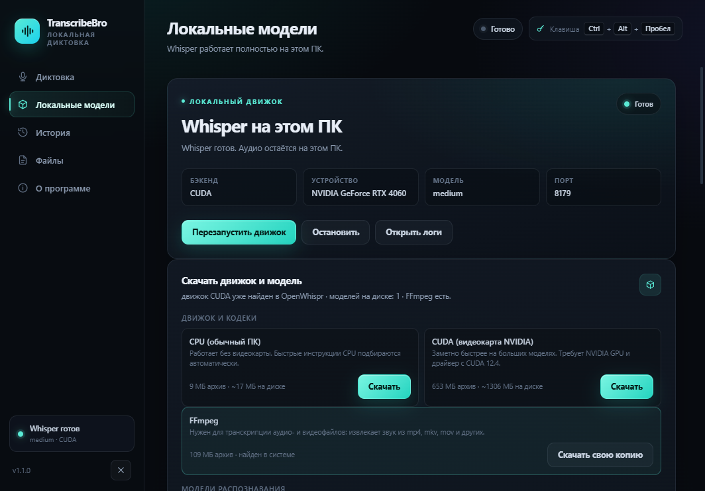

# TranscribeBro

Локальная диктовка для Windows 10/11 x64: нажал горячую клавишу — сказал — текст появился
в том окне, где ты печатаешь. Модель Whisper считается на своём же компьютере, аудио никуда
не уходит. Интерфейс — Electron, движок — whisper.cpp.



## Как это работает

1. Глобальная горячая клавиша (по умолчанию `Ctrl+Alt+Space`) запускает запись: приложение
   захватывает микрофон в 16 кГц моно и показывает индикатор уровня.
2. По второй клавише (или при отпускании в режиме удержания) аудио уходит на локальный
   `whisper-server` — он поднимается на `127.0.0.1:8178-8199` и держится в фоне.
3. Распознанный текст вставляется в активное окно через буфер обмена и возврат Ctrl+V;
   содержимое буфера восстанавливается после вставки.

## Что нужно скачать отдельно

Ничего. После установки приложение само предлагает недостающее — вкладка **«Локальные модели» →
«Скачать движок и модель»**, кнопка в один клик, без сторонних установщиков и консоли:

- **движок `whisper-server`** — официальный релиз whisper.cpp (`b5454`): CPU-сборка (~9 МБ) или
  CUDA для NVIDIA (~653 МБ). Кладётся в `%APPDATA%\TranscribeBro\bin`;
- **модель Whisper** — по умолчанию предлагается `medium` (1.5 ГБ), плюс `large-v3-turbo` и
  `large-v3` (квантованная и полная), `small`, `medium-q5_0`, `base`, `tiny` и английская
  `medium.en`. Качаются с Hugging Face в `%APPDATA%\TranscribeBro\models`;
- **FFmpeg** — нужен только для транскрипции аудио- и видеофайлов, диктовке с микрофона он не
  требуется. Там же, одной кнопкой.

Скачанное приложение предпочитает всему остальному, но если на ПК уже стоит OpenWhispr, его
сервер и модели подхватываются автоматически — повторное скачивание не нужно. Путь к своему
серверу или модели можно указать вручную в «Дополнительных путях» (`customServerPath`,
`customModelPath`). Порядок выбора модели по умолчанию: `medium` → `large-v3-turbo` →
`large-v3` → `small` → `base` → `tiny`.

VAD (Silero, `ggml-silero-v5.1.2.bin`) лежит в `bin/whisper-vad` и включается настройкой
`vadEnabled` — по умолчанию выключен.

## Горячие клавиши и режимы

- `Ctrl+Alt+Space` по умолчанию; меняется в окне настроек захватом комбинации.
- **Нажатие переключает** — нажал, говоришь, нажал ещё раз.
- **Удерживать для речи** — говоришь, пока держишь. Работает вместе с `windows-key-listener.exe`
  (низкоуровневый слушатель клавиатуры в `bin/`) — он же нужен, если назначить клавишу только
  из модификаторов.
- Куда вставлять: «Текущее окно» (после распознавания) или «Где начали» (возврат в то окно,
  где ты нажал клавишу).
- Язык распознавания: «Автоопределение» — все языки сразу, Whisper сам решает, что за речь;
  либо один из ~55 явно (русский, английский, японский и т. д.) — так точнее и быстрее, когда
  язык известен. Язык берётся из настроек и передаётся на каждый запрос в `whisper-server`,
  движок при этом поднят с `--language auto`. Английские модели (`.en`) читают только английский.

## Данные и логи

Всё в `%APPDATA%\TranscribeBro`:

| Файл | Что там |
|---|---|
| `settings.json` | настройки, горячая клавиша, режим вставки |
| `history.json` | последние 500 распознаваний |
| `logs\app.log` | лог движка и ошибок, ротация на 2 МБ |
| `audio\dictation-*.wav` | записи, если включено сохранение аудио |
| `models\` | модели, положенные вручную |

## Установка из релиза

`https://github.com/Den4dev/TranscribeBro/releases/latest` — один файл
`TranscribeBro-<версия>-Setup.exe`. Ставится в профиль без прав администратора, ярлык сразу
появляется на рабочем столе и в меню «Пуск», удаление — через «Параметры → Приложения».
Движок и модель добираются одной кнопкой в окне настроек, отдельных установок окружения не нужно.

Нужен доступ к микрофону: если Windows его запрещает, приложение скажет об этом и предложит
открыть `Параметры → Конфиденциальность → Микрофон`.

## Сборка из исходников

```
npm install
npm start
```

| Команда | Что делает |
|---|---|
| `npm start` | запуск в Electron |
| `npm run dev` | то же + окно настроек (`--dev`) |
| `npm run smoke` | прогревает движок и прогоняет WAV из `$SMOKE_WAV` (иначе `%TEMP%\opencode\test16k.wav`), выходит с кодом |
| `npm run screenshot` | открывает настройки, пишет `screenshot.png` в корень и выходит |
| `npm run dist` | `electron-builder --win nsis` → `dist\TranscribeBro-<версия>-Setup.exe` |

`bin/windows-key-listener.exe` и `bin/windows-fast-paste.exe` — готовые помощники из `bin/`:
первый нужен для режима удержания, второй вставляет текст без задержек буфера. Без второго
текст всё равно попадёт в буфер обмена — вставишь руками.

## Структура

```
main.js                 окно, трей, горячие клавиши, сценарий записи → текст
preload.js              мост renderer ↔ main
src/main/               engine.js (whisper-server), downloads.js (каталог и загрузка движка
                        и моделей), hotkey.js, paste.js, config.js,
                        history.js, logger.js, paths.js, foreground.ps1
src/renderer/           settings/recorder/overlay — интерфейс и захват микрофона
bin/                    whisper-vad (Silero), windows-key-listener.exe, windows-fast-paste.exe
```

## Лицензия

MIT — см. [LICENSE](LICENSE). Сторонние части (Electron, whisper.cpp, Silero VAD) идут под
своими лицензиями — они тоже MIT, но текст лицензии принадлежит их авторам.
